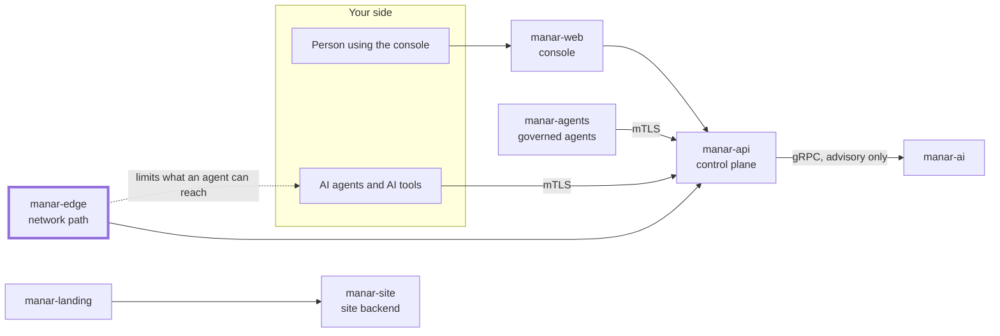

# manar-edge

Puts an AI agent's network path under Manar's control (Go, Linux and Windows host binary plus a cluster gateway).

## Where it fits in Manar

Manar is a control plane that governs AI agents and AI tools: who an agent is, what it may do,
who approves risky actions, and a tamper-evident record of what happened. This repository is the
thick-bordered box of the picture below; the other parts live in their own repositories under
[github.com/manarhq](https://github.com/manarhq).



On a governed host the agent can reach only
Manar's agent listener and the hostnames an admin allowed for it; Manar adds the path at enrollment
and cuts it on quarantine, kill switch or revocation. The design and the contract with manar-api
are in [docs/design.md](docs/design.md).

Two binaries:

- `manar-edge` (Linux, Windows): enrolls an agent, builds its jail (a network namespace whose only
  interface is a WireGuard tunnel to the Manar gateway on Linux; WireGuard plus per-program
  firewall rules on Windows), runs the local gateway on `127.0.0.1:8480` (OpenAI, Anthropic and
  MCP endpoints that forward to Manar over mTLS) and starts the agent inside the jail.
- `manar-edge-gateway` (container, runs in the Manar cluster): the WireGuard server, the relay to
  manar-api's agent listener and the hostname-filtered egress proxy, kept in sync with manar-api.

## Host quick start (Linux, as root)

```bash
manar-edge enroll --api https://manar.example        # paste <tenant>:<agent>:<secret> (hidden)
manar-edge up <agent> --task <taskId>
manar-edge install-claude-code <agent>               # optional: Claude Code hook and policy
manar-edge run <agent> -- claude
manar-edge status <agent>
manar-edge down <agent> [--purge]
```

What the host binary enforces, the Claude Code policy it installs and the Windows limits are in
[docs/host.md](docs/host.md).

## Behind a corporate proxy

The device service reaches Manar through `HTTPS_PROXY` / `NO_PROXY`. Only `http://host:port` proxies
(plain CONNECT) are supported. An `https://` or `socks5://` proxy is refused with "only http:// CONNECT
proxies are supported": the device cannot sync, and its protection stays as it is. A proxy that
opens the TLS session (inspection) fails the handshake and never receives the device certificate;
ask IT to bypass it for the Manar host.

- **Linux:** put the variables in `<state dir>/proxy.env` (for example
  `HTTPS_PROXY=http://proxy.corp.example:3128`); the systemd unit reads it, then `systemctl restart manar-edge`.
  The installer's own run uses the shell's variables.
- **Windows:** set `HTTPS_PROXY` (and `NO_PROXY`) as machine-wide (System) environment variables and
  restart the Manar device service. The WinHTTP/system proxy and PAC files are not read.

## Build and test

```bash
go vet ./...
go test -race ./...
CGO_ENABLED=0 go build -trimpath -o bin/ ./cmd/...
```

Tests that need root and network namespaces are tagged `jail` and run only when asked:
`sudo -E go test -tags jail ./...`.

## Licence and links

Licensed under the [Apache License 2.0](LICENSE). Copyright 2026 Fixio; see [NOTICE](NOTICE).
Contributions need a DCO sign-off: [CONTRIBUTING.md](CONTRIBUTING.md). Report vulnerabilities
privately: [SECURITY.md](SECURITY.md). The Manar name and logo are trademarks of Fixio:
[TRADEMARK.md](TRADEMARK.md). Everyone taking part follows the [Code of Conduct](CODE_OF_CONDUCT.md).

Product site: <https://manar.fixio.ae>
